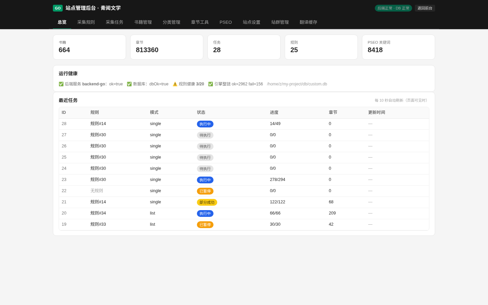
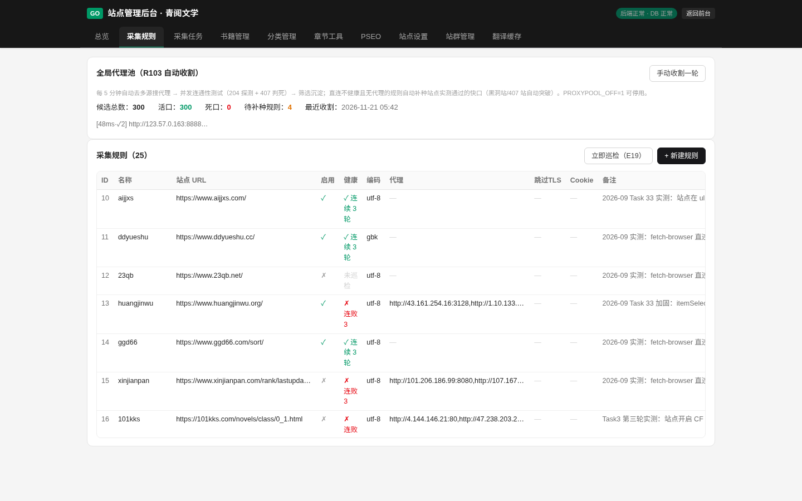
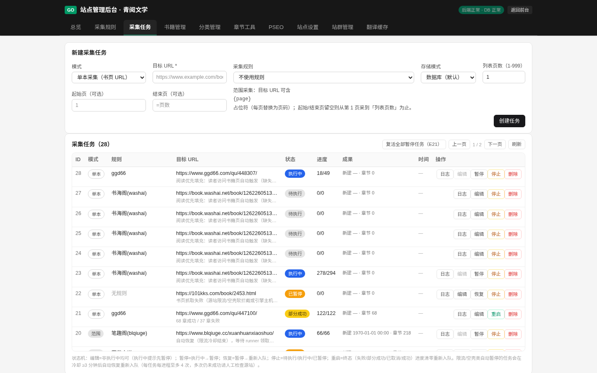
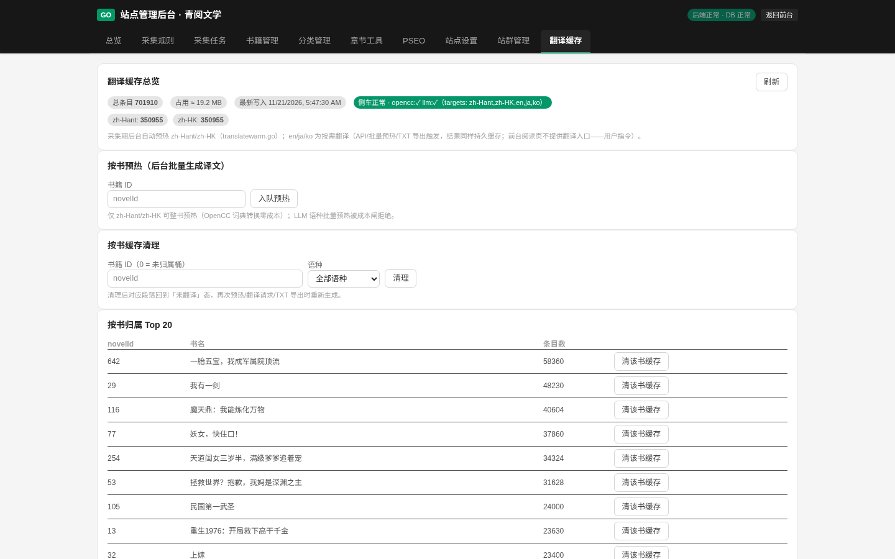
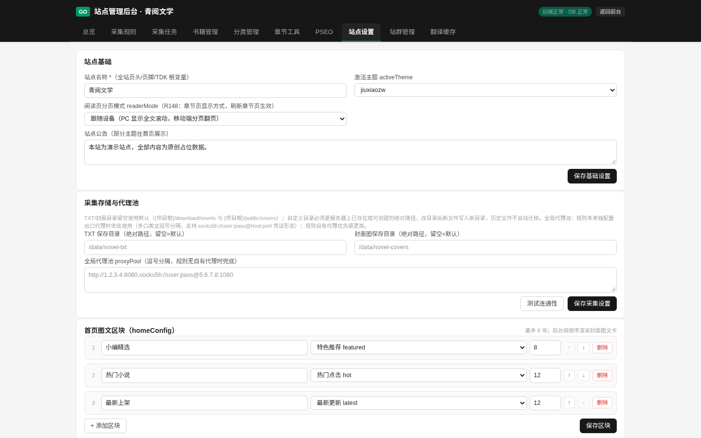

# novel-admin

**纯 Go 全栈小说管理后台** —— 内容采集（反反爬）、前台展示（1:1 复刻主题）、后台管理、翻译通道四合一。零 Node/TS 运行时依赖，双 Go 进程 + 两个 Bun/Python 侧车即可跑通全部能力。

<p align="center">
  
</p>

---

## 架构总览

| 服务 | 端口 | 运行时 | 职责 |
|---|---|---|---|
| **backend-go** | 3000 | Go 1.22 | 页面 SSR + 业务 API + 采集 runner + 空库自动播种（四合一单进程） |
| **scraper-go** | 3030 | Go 1.22 | 反反爬采集引擎（多策略链 / 域槽限速 / 车道并发） |
| **stealth-service** | 3031 | Python | 反检测侧车（cloakbrowser 隐身浏览器 + iv8 过盾） |
| **translate-service** | 3032 | Bun | 翻译服务（OpenCC 简繁即时 + LLM 英/日/韩按需） |

```
┌────────────── 浏览者 ──────────────┐
│  前台 jiuxiaozw 主题（SSR）         │
│  首页/列表/书籍页/分页阅读器         │
└──────────────┬─────────────────────┘
               │ :3000
┌──────────────▼─────────────────────┐   ┌────────────────────┐
│           backend-go               │──▶│ translate-service  │
│  SSR · API · runner · 播种          │   │ OpenCC + LLM 缓存   │
│  SQLite (modernc.org/sqlite 纯 Go) │   └────────────────────┘
└──────────────┬─────────────────────┐   ┌────────────────────┐
               │ :3030                ──▶│ stealth-service    │
┌──────────────▼─────────────────────┐   │ cloakbrowser + iv8 │
│           scraper-go               │   └────────────────────┘
│  策略链 fetch 直连/browser/cloak    │
│  域槽限速 · 车道并发 · 高水位记忆     │
└────────────────────────────────────┘
```

## 核心特性

### 前台（1:1 复刻主题 `jiuxiaozw`）
- **分页阅读器**：CSS columns + translateX 与原站同机制，四向滑动翻页 + 页面预览影子层
- **双模式**：后台 `readerMode` 设置——`auto`（PC 全文滚动 / 触屏分页）、`scroll`、`page` 三态
- **阅读器设置面板**：字号 / 行距 / 纸色（米色 / 白纸 / 护眼 / 夜间），变量口径与原站一致
- **断点续读**：书页 CTA 自动升级「继续阅读」并直指上次章节；章内页码 + 书级进度双持久化
- **响应式**：移动端悬浮工具栏 / 热区 / 手势，桌面端滚动模式 + 键盘章导航

### 采集引擎（scraper-go）
- **策略链**：fetch 直连 → cloaked 浏览器 → stealth 过盾，逐站自适应
- **域槽限速**：每主机 ≥1.2s 间隔 + 出口池轮换，防封优先
- **车道并发**：AIMD 爬坡 + 软起步 + **高水位记忆**（健康宽度跨重启复用，免重爬坡）
- **目录完整性**：chapterListApi HTTP/2 强制升级 + JS cookie 挑战兜底 + 骨架词面折叠防重复
- **规则健康巡检**：失败连计/自动停用/notes 死亡定性留档

### 翻译（纯后台通道）
- 采集期自动预热 zh-Hant/zh-HK（OpenCC 零成本）；en/ja/ko LLM 按需 + 持久缓存
- TXT 译文导出：`POST /api/novels/:id/export-txt?lang=zh-Hant`
- 管理端：缓存总览 / 按书预热 / 清理 / 归属统计（前台阅读页无翻译入口）

### 管理后台
- 采集规则 / 任务 fleet / 书籍分类章节 / PSEO / 站点设置 / 站群管理 / 翻译缓存九大板块

## 页面截图

| 前台 · 桌面 | 前台 · 移动 |
|---|---|
|  |  |
|  |  |

| 阅读器 · PC 全文滚动 | 阅读器 · 移动分页 |
|---|---|
|  |  |

| 设置面板（字号/行距/纸色） | 管理后台总览 |
|---|---|
|  |  |

| 采集规则 | 采集任务 fleet |
|---|---|
|  |  |

| 翻译缓存 | 站点设置 |
|---|---|
|  |  |

## 快速开始

国内服务器一键安装（阿里镜像加速，预构建二进制快速路径）：

```bash
bash -c "$(curl -fsSL https://ghfast.top/https://raw.githubusercontent.com/u4399com-beep/novel-admin-1.0.0/main/scripts/bootstrap-cn.sh)"
```

或指定安装目录：

```bash
BOOTSTRAP_TARGET=/opt/novel-admin bash -c "$(curl -fsSL https://ghfast.top/https://raw.githubusercontent.com/u4399com-beep/novel-admin-1.0.0/main/scripts/bootstrap-cn.sh)"
```

安装完成后访问 `http://<服务器IP>:3000` 打开前台，`/admin` 进入管理后台。

### 手动构建

```bash
# 依赖：Go 1.22+（运行时）；bun（translate-service）；python3（stealth-service，可选）
scripts/build-go.sh          # 编译双 Go 进程
mini-services/backend-go/run.sh    # 启动 backend（:3000）
mini-services/scraper-go/run.sh     # 启动采集引擎（:3030）
mini-services/stealth-service/run.sh    # 启动反检测侧车（:3031，可选）
mini-services/translate-service/run.sh  # 启动翻译服务（:3032）
```

## 目录结构

```
├── mini-services/
│   ├── backend-go/          # 主服务（SSR/API/runner/播种）
│   │   ├── web/templates/   # 各主题模板（jiuxiaozw 为 1:1 复刻主题）
│   │   ├── web/static/      # 主题 CSS/JS
│   │   └── bin/             # 预构建二进制
│   ├── scraper-go/          # 采集引擎
│   ├── stealth-service/     # cloakbrowser/iv8 反检测侧车
│   └── translate-service/   # OpenCC + LLM 翻译
├── scripts/                 # 构建/部署/守护脚本
├── docs/                    # 部署/运维/规则/反反爬文档
│   ├── images/              # 页面截图（本 README 引用）
│   └── deployment.md        # 零基础图文部署教程
└── db/                      # SQLite 数据库（运行时生成）
```

## 技术要点

- **SQLite 纯 Go 驱动**（modernc.org/sqlite）：零 CGO，交叉编译友好，单文件部署
- **模板运行时加载**：主题模板/静态资源磁盘直读，改样式无需重编译
- **幂等加列**：schema 变更通过 ensureColumn 自动补齐，存量库无损升级
- **原子落盘**：车道地板/高水位等热缓存 tmp+rename 原子写，重启恢复链完整
- **质量闸**：`go test ./...` 全量回归 + `gofmt/vet/staticcheck` 零输出 + 浏览器 E2E

## 文档索引

| 文档 | 内容 |
|---|---|
| [docs/deployment.md](docs/deployment.md) | 零基础图文部署教程（从装系统开始） |
| [docs/anti-anti-crawl.md](docs/anti-anti-crawl.md) | 反反爬体系说明 |
| [docs/scrape-rules.md](docs/scrape-rules.md) | 采集规则字段与形态 |
| [docs/operations-readiness.md](docs/operations-readiness.md) | 运维就绪手册 |
| [docs/recovery-playbook.md](docs/recovery-playbook.md) | 故障恢复手册 |

## 免责声明

本项目为**演示/学习用途**。前台展示的内容来自公开互联网采集，版权归原站及原作者所有；示例站点标注「演示站点，全部内容为原创占位数据」。请勿将本项目用于商业用途，下载后请在 24 小时内自行评估保留必要性。
